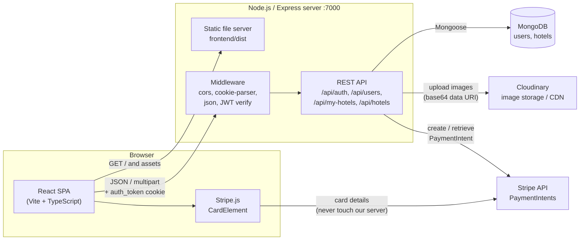
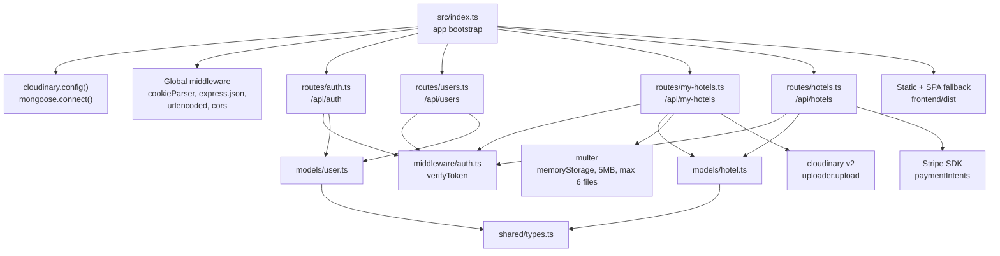
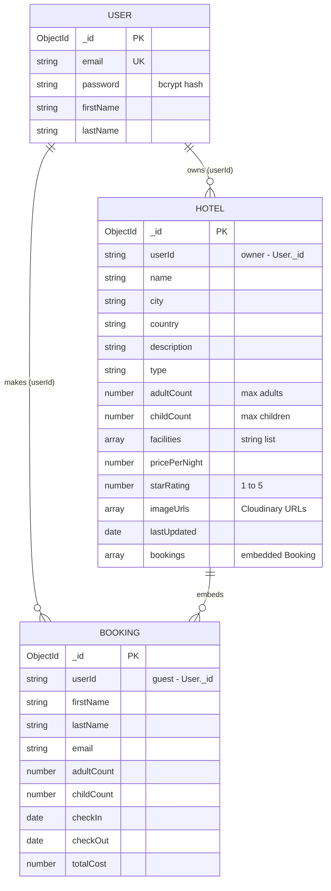
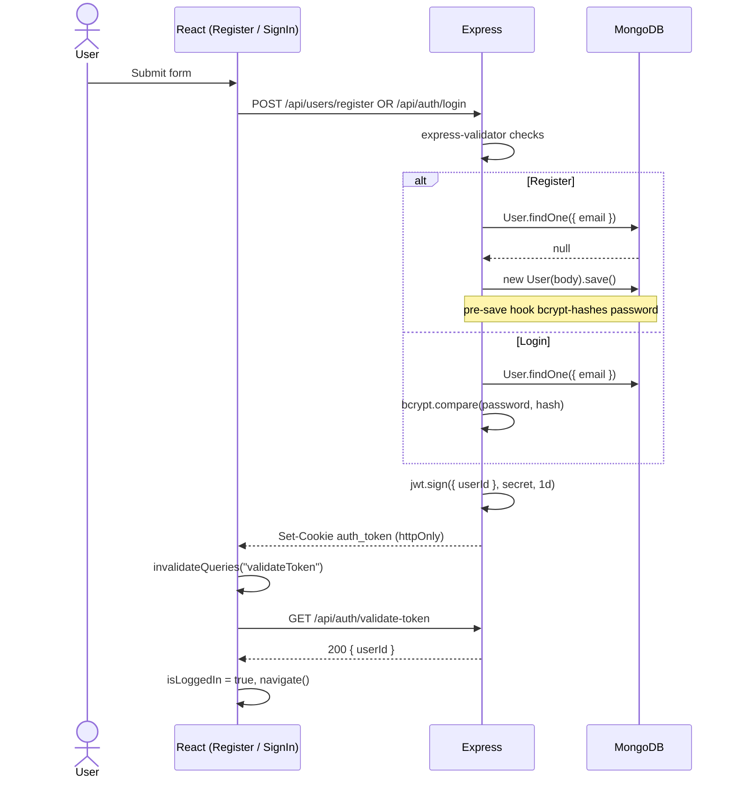
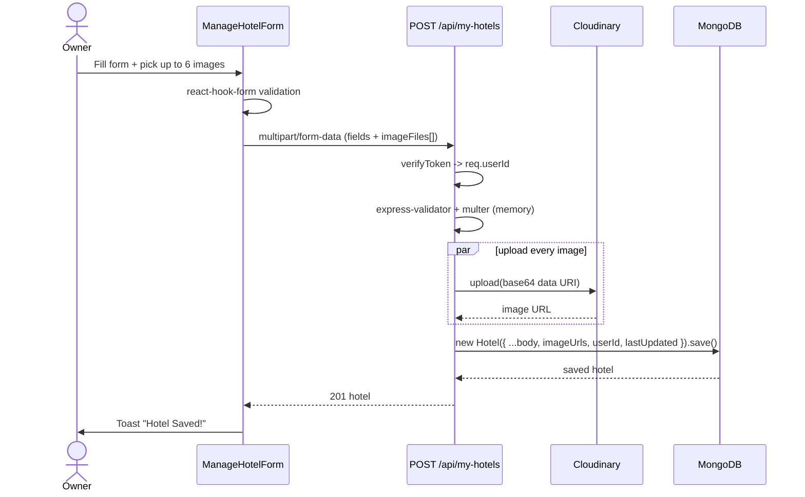
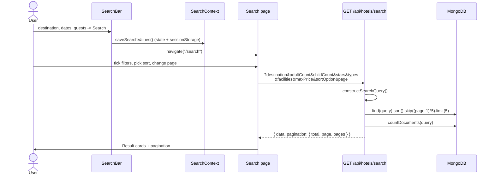
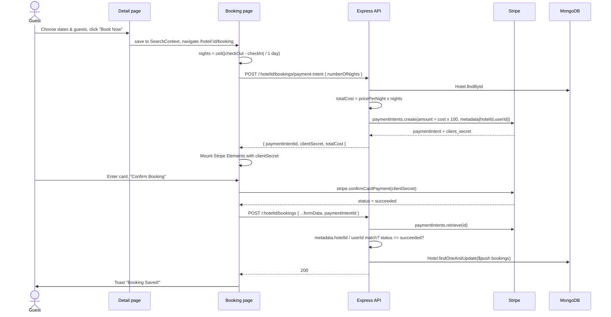
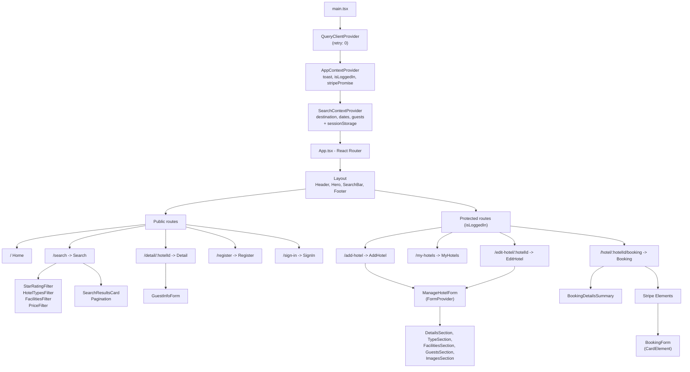

# MernHolidays - Hotel Booking Platform

A full-stack, two-sided hotel marketplace built on the MERN stack with TypeScript. Anyone can search and browse hotels; registered users can **list their own hotels** and **book stays with real card payments via Stripe**.


---

## Table of Contents

1. [Features](#features)
2. [Tech Stack](#tech-stack)
3. [High-Level Design (HLD)](#high-level-design-hld)
4. [Low-Level Design (LLD)](#low-level-design-lld)
5. [API Reference](#api-reference)
6. [Project Structure](#project-structure)
7. [Getting Started](#getting-started)
8. [Environment Variables](#environment-variables)
9. [Scripts](#scripts)
10. [Design Decisions](#design-decisions)

---

## Features

### 1. Authentication & Session Management
- **Register** with first name, last name, email and password (min. 6 chars, confirm-password check on the client, duplicate-email check on the server).
- **Sign in / Sign out** using email + password.
- Passwords are hashed with **bcrypt** (via a Mongoose `pre("save")` hook, only when the password field is modified).
- Sessions use a **JWT (1-day expiry) stored in an `httpOnly` cookie** named `auth_token` (`secure` in production). The token is never exposed to JavaScript.
- On every app load the frontend calls `/api/auth/validate-token`; the result drives `isLoggedIn`, which gates protected routes and the header UI.
- After sign-in, users are redirected back to the page they came from (e.g. a hotel they tried to book while logged out).

### 2. Hotel Management (for hotel owners)
- **Add Hotel** - name, city, country, description, price per night, star rating (1-5), hotel type (15 options), facilities (8 options), max adults/children, and up to **6 images**.
- **My Hotels** - dashboard listing only the hotels created by the logged-in user.
- **Edit Hotel** - pre-filled form; existing images can be removed, new images added (total capped at 6).
- Images are uploaded via **Multer** (in-memory, 5 MB per file limit), pushed to **Cloudinary** in parallel, and only the resulting URLs are stored in MongoDB.
- Ownership is enforced server-side: every `/api/my-hotels` query filters on `userId` from the verified JWT, so users can only read/edit their own hotels.

### 3. Search & Discovery
- **Search bar** (persistent across pages): destination, check-in, check-out, adults, children.
- Destination matches **city or country**, case-insensitive partial match (regex).
- **Filters** (combinable): star rating (multi-select), hotel type (multi-select), facilities (hotel must have *all* selected), max price per night.
- **Sorting**: star rating, price low-to-high, price high-to-low.
- **Server-side pagination** (5 results per page) with total count and page count.
- Search state is kept in a React context **and mirrored to `sessionStorage`**, so it survives a page refresh.

### 4. Hotel Detail Page
- Star rating, name, image gallery, facilities grid, description, and a **guest info panel** (dates, adults, children) that pre-fills from the current search.
- Button adapts to auth state: **"Book Now"** if logged in, **"Sign in to Book"** otherwise (and returns the user to the hotel after login).

### 5. Booking & Payment (Stripe)
- Booking page shows a summary (hotel, location, dates, number of nights, guests) alongside a confirmation form with user details pre-filled from the account.
- **Server-calculated pricing**: the client sends only the number of nights; the server loads the hotel, computes `pricePerNight x nights`, and creates a **Stripe PaymentIntent** with `hotelId` and `userId` stored in its metadata.
- Card entry uses Stripe's `CardElement`; payment is confirmed client-side with `stripe.confirmCardPayment`.
- After a successful payment, the client calls the booking endpoint. The server **re-verifies with Stripe** that the PaymentIntent exists, belongs to this hotel and this user, and has status `succeeded` before the booking is pushed into the hotel document.

### 6. UX Details
- Toast notifications (auto-dismiss after 5 s) for success and error states.
- Client-side form validation with `react-hook-form`; server-side validation with `express-validator`.
- Responsive layout with Tailwind CSS.
- Data fetching, caching and mutation state handled by React Query.

---

## Tech Stack

| Layer | Technology |
|---|---|
| **Frontend** | React 18, TypeScript, Vite (SWC), React Router v6, React Query v3, React Hook Form, Tailwind CSS, react-datepicker, react-icons |
| **Payments (client)** | `@stripe/stripe-js`, `@stripe/react-stripe-js` |
| **Backend** | Node.js, Express 4, TypeScript (CommonJS build), Mongoose 8 |
| **Auth** | `jsonwebtoken`, `bcryptjs`, `cookie-parser` |
| **Validation** | `express-validator` (server), `react-hook-form` (client) |
| **File upload** | `multer` (memory storage) + Cloudinary SDK |
| **Payments (server)** | `stripe` Node SDK |
| **Database** | MongoDB (works with Atlas or a local instance) |

---

## High-Level Design (HLD)

The system is a classic three-tier web app plus two third-party services. In production a **single Node process** serves both the REST API and the compiled React bundle, which keeps everything same-origin (so the auth cookie needs no cross-site configuration).



### Key architectural points
| Concern | Approach |
|---|---|
| **Authentication** | Stateless JWT in an `httpOnly` cookie; `verifyToken` middleware decodes it and attaches `req.userId`. |
| **Authorization** | Resource ownership enforced in queries (`{ _id, userId }`) rather than separate role checks. |
| **Image handling** | Files never hit disk: Multer memory buffer -> base64 data URI -> Cloudinary -> URL stored in DB. |
| **Payments** | Card data goes browser -> Stripe directly (PCI scope stays with Stripe). Server only creates and verifies PaymentIntents. |
| **Data modelling** | Two collections (`users`, `hotels`); bookings are **embedded** inside the hotel document. |
| **Type sharing** | Frontend imports TS types straight from `backend/src/shared/types.ts`, giving one source of truth for API contracts. |
| **Deployment shape** | Express serves `frontend/dist` and falls back to `index.html` for unknown GET routes (SPA routing). |

---

## Low-Level Design (LLD)

### 1. Backend module structure



### 2. Data model (MongoDB / Mongoose)

Bookings are a **sub-document array** on `Hotel`. `userId` fields are stored as plain strings (the user's `_id`), not Mongoose `ref`s.



### 3. Sequence - Registration & Login



### 4. Sequence - Add a hotel with images



### 5. Sequence - Search with filters



### 6. Sequence - Booking & payment (the critical flow)



### 7. Frontend component tree



### 8. Frontend data layer

| Concern | Implementation |
|---|---|
| **API access** | Every HTTP call lives in `src/api-client.ts` - components never call `fetch` directly. All authenticated calls use `credentials: "include"`. |
| **Server state** | React Query `useQuery` / `useMutation`. Auth state is the `validateToken` query; sign-in/out/register invalidate it to flip `isLoggedIn` instantly. |
| **Global UI state** | `AppContext` (toast + auth + Stripe promise) and `SearchContext` (search criteria, persisted to `sessionStorage`). |
| **Forms** | `react-hook-form`; the hotel form is split into section components sharing state through `FormProvider` / `useFormContext`. Hotel data is sent as `FormData` to support files. |
| **Shared types** | Imported from `backend/src/shared/types.ts`. |

---

## API Reference

Base URL: `http://localhost:7000` (dev). Auth = requires the `auth_token` cookie.

| Method | Endpoint | Auth | Description |
|---|---|:-:|---|
| `POST` | `/api/users/register` | - | Create account, sets auth cookie. Body: `firstName, lastName, email, password(>=6)` |
| `GET` | `/api/users/me` | Yes | Current user profile (password excluded) |
| `POST` | `/api/auth/login` | - | Body: `email, password`. Sets auth cookie, returns `{ userId }` |
| `GET` | `/api/auth/validate-token` | Yes | Returns `{ userId }` if the cookie is valid |
| `POST` | `/api/auth/logout` | - | Clears the auth cookie |
| `POST` | `/api/my-hotels` | Yes | Create hotel. `multipart/form-data`, up to 6 `imageFiles` (5 MB each) |
| `GET` | `/api/my-hotels` | Yes | List hotels owned by the current user |
| `GET` | `/api/my-hotels/:id` | Yes | Get one owned hotel |
| `PUT` | `/api/my-hotels/:hotelId` | Yes | Update owned hotel; new `imageFiles` are prepended to retained `imageUrls` |
| `GET` | `/api/hotels/search` | - | Search; see query params below |
| `GET` | `/api/hotels/:id` | - | Public hotel details |
| `POST` | `/api/hotels/:hotelId/bookings/payment-intent` | Yes | Body: `{ numberOfNights }`. Returns `{ paymentIntentId, clientSecret, totalCost }` |
| `POST` | `/api/hotels/:hotelId/bookings` | Yes | Body: booking details + `paymentIntentId`. Verifies payment, then stores booking |

**`GET /api/hotels/search` query parameters**

| Param | Type | Behaviour |
|---|---|---|
| `destination` | string | Case-insensitive match on city **or** country |
| `adultCount` / `childCount` | number | Hotels whose capacity is `>=` the value |
| `facilities` | string or string[] | Hotel must have **all** listed facilities |
| `types` | string or string[] | Hotel type must be **one of** the listed values |
| `stars` | string or string[] | Star rating must be one of the listed values |
| `maxPrice` | number | `pricePerNight <= maxPrice` |
| `sortOption` | `starRating` \| `pricePerNightAsc` \| `pricePerNightDesc` | Sort order |
| `page` | number | 1-based, page size is 5 |

---

## Project Structure

```
mern-booking-app/
├── backend/
│   ├── package.json
│   ├── tsconfig.json              # outDir: ./dist, CommonJS
│   └── src/
│       ├── index.ts               # app bootstrap, middleware, static hosting
│       ├── middleware/
│       │   └── auth.ts            # verifyToken (JWT cookie -> req.userId)
│       ├── models/
│       │   ├── user.ts            # User schema + bcrypt pre-save hook
│       │   └── hotel.ts           # Hotel schema + embedded Booking schema
│       ├── routes/
│       │   ├── auth.ts            # login, validate-token, logout
│       │   ├── users.ts           # register, me
│       │   ├── my-hotels.ts       # owner CRUD + image upload
│       │   └── hotels.ts          # public search/detail + Stripe booking
│       └── shared/
│           └── types.ts           # types shared with the frontend
└── frontend/
    ├── package.json
    ├── vite.config.ts / tailwind.config.js / tsconfig*.json
    └── src/
        ├── main.tsx               # providers (React Query, App, Search contexts)
        ├── App.tsx                # route table
        ├── api-client.ts          # all HTTP calls
        ├── config/hotel-options-config.ts   # hotel types & facilities lists
        ├── contexts/              # AppContext, SearchContext
        ├── layouts/Layout.tsx
        ├── pages/                 # Register, SignIn, Search, Detail, Booking,
        │                          # AddHotel, EditHotel, MyHotels
        ├── forms/
        │   ├── ManageHotelForm/   # Details, Type, Facilities, Guests, Images sections
        │   ├── GuestInfoForm/
        │   └── BookingForm/
        └── components/            # Header, Hero, Footer, SearchBar, filters,
                                   # SearchResultsCard, Pagination, Toast, ...
```

---

## Getting Started

### Prerequisites
- Node.js 18+ and npm
- A MongoDB connection string (MongoDB Atlas free tier or local `mongod`)
- A [Cloudinary](https://cloudinary.com) account (cloud name, API key, API secret)
- A [Stripe](https://stripe.com) account in **test mode** (secret key + publishable key)

### 1. Clone and install
```bash
git clone https://github.com/ShreyanshPachouri/mern-booking-app.git
cd mern-booking-app

cd backend && npm install
cd ../frontend && npm install
```

### 2. Configure environment variables
Create `backend/.env` and `frontend/.env` using the tables in the next section.

### 3. Run in development (two terminals)
```bash
# Terminal 1 - API on http://localhost:7000
cd backend
npm run dev

# Terminal 2 - Vite dev server on http://localhost:5173
cd frontend
npm run dev
```
Open http://localhost:5173. Use Stripe's test card `4242 4242 4242 4242` with any future expiry and any CVC to try a booking.

### 4. Production-style run (single server)
```bash
# Build the frontend
cd frontend
npx vite build

# Build and start the backend (it serves frontend/dist)
cd ../backend
npm run build
npm start               # http://localhost:7000
```
For this mode, leave `VITE_API_BASE_URL` empty so the frontend calls the same origin, and set `NODE_ENV=production` so the auth cookie is marked `secure` (requires HTTPS).

---

## Environment Variables

**`backend/.env`**

| Variable | Description |
|---|---|
| `MONGODB_CONNECTION_STRING` | MongoDB connection URI |
| `JWT_SECRET_KEY` | Long random string used to sign JWTs |
| `FRONTEND_URL` | Allowed CORS origin, e.g. `http://localhost:5173` |
| `CLOUDINARY_CLOUD_NAME` | Cloudinary cloud name |
| `CLOUDINARY_API_KEY` | Cloudinary API key |
| `CLOUDINARY_API_SECRET` | Cloudinary API secret |
| `STRIPE_API_KEY` | Stripe **secret** key (`sk_test_...`) |
| `NODE_ENV` | Set to `production` when deployed (enables `secure` cookies) |

**`frontend/.env`**

| Variable | Description |
|---|---|
| `VITE_API_BASE_URL` | Backend origin in dev, e.g. `http://localhost:7000`. Leave empty when the backend serves the frontend. |
| `VITE_STRIPE_PUB_KEY` | Stripe **publishable** key (`pk_test_...`) |

> Never commit `.env` files - they are already git-ignored.

---

## Scripts

| Location | Command | What it does |
|---|---|---|
| backend | `npm run dev` | Starts the API with `nodemon` (TypeScript via `ts-node`) |
| backend | `npm run build` | Installs dependencies and compiles TS to `dist/` |
| backend | `npm start` | Runs the compiled server `node ./dist/index.js` |
| frontend | `npm run dev` | Vite dev server with HMR |
| frontend | `npm run build` | `tsc -b && vite build` |
| frontend | `npm run lint` | ESLint (zero warnings allowed) |
| frontend | `npm run preview` | Preview the production build |

---

## Design Decisions

- **httpOnly cookie over localStorage for the JWT** - protects the token from XSS; the browser attaches it automatically (`credentials: "include"`).
- **Server-side price calculation** - the client never sends a price; it sends nights and the server derives the cost from the DB, so a user cannot tamper with the amount charged.
- **Payment verified before booking is written** - the booking endpoint re-fetches the PaymentIntent from Stripe and checks status plus hotel/user metadata, rather than trusting the client.
- **Embedded bookings** - bookings live inside the hotel document, so a hotel and its bookings are read/written in one operation.
- **Memory-based uploads straight to Cloudinary** - no temp files on the server, which suits ephemeral hosting.
- **Single-origin production deploy** - Express serves the SPA, avoiding cross-site cookie and CORS complexity.
- **Shared TypeScript types** - the frontend imports backend types directly, so the API contract cannot silently drift.

---

## Author

**Shreyansh Pachouri** - [GitHub](https://github.com/ShreyanshPachouri)
